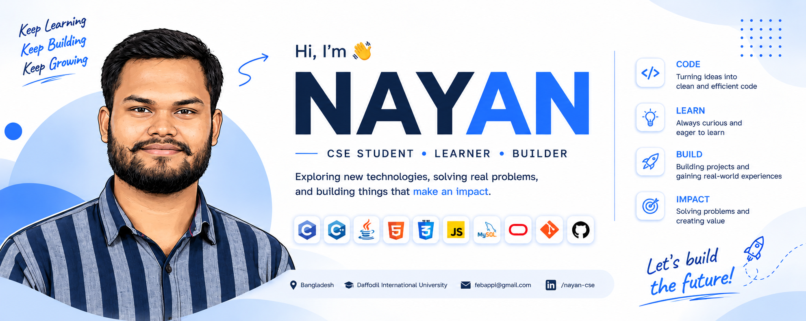

<!-- :) copy :) ===================== BANNER ===================== -->

  

<!-- ===================== INTRO ===================== -->

<h1 align="center">NAYAN DAS</h1>

<h3 align="center">
  CSE Aspirant · Full-Stack Developer in Progress
</h3>

  
  
  

## 👨‍💻 About Me  
I am a part-time **Full Stack Developer** and a Computer Science and Engineering undergraduate, gearing up to transition into a full-time engineering. I specialize in building high-performance, modern web applications using **React**, **Next.js App Router**, and **TypeScript**. 

Beyond crafting user interfaces, I am actively exploring **Blockchain smart contract development**, alongside my academic focus on core engineering. 

- 🔭 **I’m currently working on:** Modern web applications like **Fit-Log** (a daily planning & workout tracker) and **Movie Explorer**.
- 🌱 **I’m currently exploring:** Blockchain development and advanced/3D computer software.
- 👯 **I’m looking to collaborate on:** Open-source React, Next.js, and TypeScript projects.
- ⚡ **Fun fact:** I balance building responsive front-end UI and backend components with academic curriculums.

---

## 🌐 **Portfolio:**

  

## 🛠️ Tech Stack  

### **Frontend & Frameworks**

### **Tools & Deployment**

---

## 🚀 Featured Projects

- **[Fit-Log](https://github.com/nayancsbd/fit-log.git):** A workout and daily planning web application built with Next.js, featuring interactive UI components and deployed via Vercel.
- **[Movie Explorer](https://github.com/nayancsbd/Movie-Explorer-Application.git):** A modular application built with Vite, React, and TypeScript, utilizing Tailwind CSS for a highly responsive design.
- **[dev-stack](https://github.com/nayancsbd/dev-stack.git):** A configured full-stack development environment setup with automated Git workflows.

---

## 📊 GitHub Stats  

  

  
  

## 🔥 Contribution Streak

  

 

---

## 🌐 Connect With Me  

  

